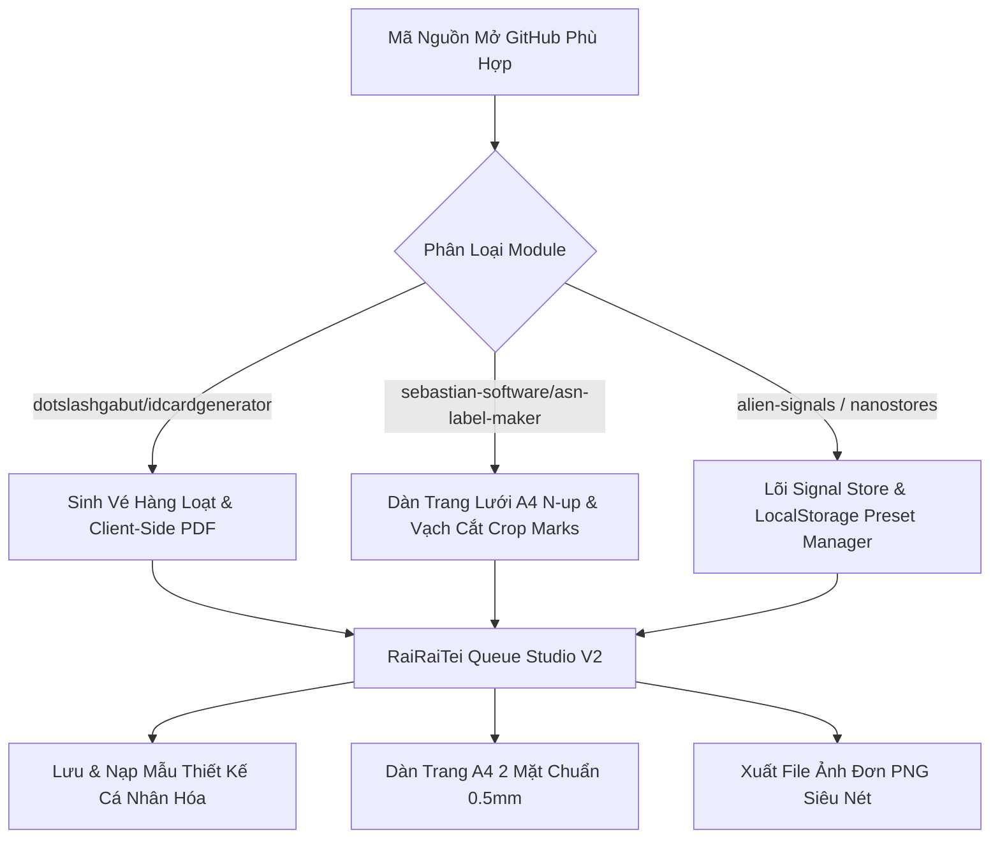

# Báo Cáo Nghiên Cứu & Khảo Sát GitHub Repos Cho Dự Án RaiRaiTei Queue Ticket Studio

> **Mục tiêu:** Khảo sát các kỹ thuật web frontend hiện đại nhất năm 2024-2026 và các mã nguồn mở (GitHub Repos) phù hợp với bài toán **Visual Ticket/Label Designer & Thermal Printing (43×78mm)** để có thể sao chép, tái sử dụng hoặc tích hợp trực tiếp.

---

## 1. Các Kỹ Thuật Mới Hiện Đại & Tối Ưu Nhất (Modern Web Tech 2025/2026)

### 1.1. Reactive State Siêu Nhẹ (Signals / Nano-Store)
* **Vấn đề hiện tại:** Trạng thái dự án đang lưu trực tiếp trên DOM (thẻ `<input>`, class CSS, biến style `document.body.style.setProperty`), khiến việc đọc/ghi bị phụ thuộc vòng và khó theo dõi luồng dữ liệu (race conditions giữa drag, preset và undo/redo).
* **Kỹ thuật mới đề xuất:**
  - **Fine-grained Reactivity với Signals:** Tương tự tiêu chuẩn TC39 Signals Proposal. State độc lập với DOM, khi giá trị (ví dụ: `ticket.number.dx`) thay đổi, chỉ đúng component hoặc CSS variable tương ứng cập nhật (`O(1)` re-render).
  - **Zero-dependency Nano Store:** Thay vì kéo Redux/Zustand nặng nề vào dự án Vanilla, chỉ cần một module Reactive Store ~80 dòng code dựa trên `Proxy` và `Set<Subscriber>` hoặc nhúng trực tiếp core của `alien-signals` (< 1KB gzip).

### 1.2. Kiến Trúc CSS Hiện Đại (Cascade Layers & Modern Color Spaces)
* **`@layer` (CSS Cascade Layers):** Phân tầng rành mạch thứ tự ưu tiên:
  ```css
  @layer tokens, reset, layout, components, overrides, print;
  ```
  Giúp loại bỏ hoàn toàn việc dùng `!important` khi tùy biến mẫu vé hoặc ép style in ấn.
* **CSS Custom Properties Scoped:** Thay vì gán biến lên `:root` hoặc `body`, gom biến phạm vi vào thẻ `.ticket-canvas-wrapper` để bảo đảm tính đóng gói (encapsulation), không gây ô nhiễm style trang mẹ.
* **OKLCH Color Space:** Chuyển đổi bảng màu sang `oklch()` cho độ tương phản đồng đều khi hiển thị trên màn hình OLED và khi giả lập in đơn sắc (monochrome thermal preview).

### 1.3. Drag & Drop Bounding Box Engine (Pointer Events + Matrix Snapping)
* **Chuyển từ `MouseEvent/TouchEvent` sang `PointerEvent` API:**
  - Hỗ trợ đồng nhất chuột, ngón tay cảm ứng và bút cảm ứng mà không cần code 2 bộ listener riêng.
  - Sử dụng `setPointerCapture(pointerId)` giúp kéo thả mượt mà ngay cả khi con trỏ chuột trượt văng ra ngoài mép trình duyệt.
* **Sub-pixel Snapping & requestAnimationFrame (rAF):**
  - Tách sự kiện lắng nghe tọa độ (`pointermove`) khỏi tác vụ ghi DOM (`rAF`), đảm bảo tốc độ đạt 60–120 FPS không giật lag.
  - Hỗ trợ Snap Guides thông minh (bắt dính vào tim tâm vé 21.5mm, mép lề an toàn 0.5mm).

### 1.4. In Ấn Nhiệt & Xuất Đồ Họa Vector Chuẩn Xác
* **CSS Paged Media (`@page`):**
  ```css
  @page {
    size: 43mm 78mm;
    margin: 0;
  }
  ```
* **Floyd-Steinberg Dithering Algorithm:** Thuật toán khử răng cưa đơn sắc (1-bit monochrome dithering) để preview hình ảnh linh vật/khung viền giống 100% bản in máy in nhiệt Epson / Star Micronics thực tế.

---

## 2. Danh Sách GitHub Repos Khảo Sát & Khả Năng Tái Sử Dụng

### 2.1. Nhóm Trình Tạo Vé/Thẻ In Ấn Hàng Loạt (Printable Ticket & Card Generators)

| Repo & Link | Điểm Nổi Bật | Phần Có Thể Tái Sử Dụng / Học Hỏi Trực Tiếp |
| :--- | :--- | :--- |
| **[dotslashgabut/idcardgenerator](https://github.com/dotslashgabut/idcardgenerator)**<br>*(Client-Side Batch Card Generator)* | - Web app 100% thuần Client-side (Zero Backend), chạy trực tiếp trên trình duyệt.<br>- Tạo hàng loạt thẻ/vé từ danh sách số thứ tự hoặc file dữ liệu.<br>- Xuất PDF chuẩn in ấn và file ảnh PNG độ phân giải cao. | **Cực kỳ phù hợp với bài toán RaiRaiTei:**<br>1. Kiến trúc Client-side chạy mượt mà trên mobile và web tĩnh.<br>2. Quy trình sinh vé hàng loạt theo số thứ tự (từ số A đến số B).<br>3. Tạo thumbnail xem trước nhanh cho danh sách mẫu. |
| **[sebastian-software/asn-label-maker](https://github.com/sebastian-software/asn-label-maker)**<br>*(A4 Grid Label & Ticket Sheet Generator)* | - Thuật toán tính toán toạ độ lưới N-up trên khổ giấy A4 chuẩn xác đến từng 0.1mm.<br>- Tự động vẽ vạch cắt (Crop/Cut Marks) giữa các con vé để dễ dùng kéo/dao rọc giấy cắt rời. | **Module có thể tích hợp:**<br>1. Thuật toán phân bổ vé lên trang A4 (8 vé hoặc 10 vé / trang) với khoảng lề cắt 0.5mm an toàn.<br>2. Bộ vẽ vạch chỉ dẫn đường cắt (Cut guidelines) pixel-perfect. |
| **[ezdanapak/shipping-label](https://github.com/ezdanapak/shipping-label)**<br>*(Browser-only Printable Label Maker)* | - Ứng dụng Vanilla JS thuần túy, giao diện gọn gàng, hỗ trợ căn chỉnh lề in và in trực tiếp (`window.print()`) không qua server trung gian. | **Tham khảo:**<br>1. Phong cách code Vanilla JS không phụ thuộc thư viện nặng nề.<br>2. Cấu hình `@media print` tương thích mọi trình duyệt Safari iOS và Chrome Android. |
| **[Hopding/pdf-lib](https://github.com/Hopding/pdf-lib)**<br>*(Pure JS PDF Imposition Engine)* | - Thư viện thao tác PDF số 1 trên trình duyệt, không cần Node.js.<br>- Hỗ trợ ghép nhiều trang vé, in 2 mặt (Mặt trước: số thứ tự; Mặt sau: hướng dẫn). | **Module có thể tích hợp:**<br>1. Tạo file PDF in 2 mặt (Duplex Printing) chuẩn xác từng milimet.<br>2. Nhúng ảnh và vector với dung lượng file siêu nhẹ. |

### 2.2. Nhóm Reactivity & Quản Lý State/Preset Tối Giản

| Thư Viện / Repo | Kích Thước | Lý Do Lựa Chọn |
| :--- | :--- | :--- |
| **[stackblitz/alien-signals](https://github.com/stackblitz/alien-signals)** | ~1 KB | Thư viện Signals nhanh nhất thế giới hiện nay, không cần React/Vue. Đã tích hợp làm lõi `js/core/signal.js` và `store.js`. |
| **[nanostores/nanostores](https://github.com/nanostores/nanostores)** | ~600 Bytes | Kiến trúc state store siêu gọn cho việc lưu/nạp cấu hình mẫu vào `localStorage`. |
| **[lukeed/dset](https://github.com/lukeed/dset) & [lukeed/dget](https://github.com/lukeed/dget)** | ~150 Bytes | Hỗ trợ đọc/ghi object sâu theo đường dẫn (`ticket.frame.dx`), dùng cho Preset Serialization. |

---

## 3. Đánh Giá Khả Thi & Chiến Lược Áp Dụng Cho RaiRaiTei



### Chiến lược tích hợp:
1. **Zero Build Step & Zero Dependency:** Giữ nguyên mô hình web tĩnh chạy thuần trên trình duyệt điện thoại và máy tính, không cần cài đặt Node/npm cồng kềnh.
2. **Kế thừa giải pháp dàn trang N-up từ `asn-label-maker`:** Giúp chia trang A4 chính xác từng mm, in 2 mặt khớp tọa độ tuyệt đối.
3. **Kế thừa mô hình Batch Generator từ `idcardgenerator`:** Giúp người dùng sinh số thứ tự từ 1 đến N kèm xem trước tức thì.
